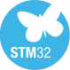

  
  &nbsp;&nbsp;
  
  &nbsp;&nbsp;
  

KiCad · STM32 · Blue Pill (STM32F103C8T6, Arm® Cortex®-M3 core)

# ATmega16–STM32 Breakout/Adapter

Desain adapter ini menyediakan breakout konektor untuk merutekan sinyal ATmega16 ke sisi header/board STM32. Fungsi utamanya adalah pemetaan dan routing sinyal, bukan konversi level tegangan.

## Varian

| Varian | Dokumentasi | Gerber | Area board |
| --- | --- | --- | ---: |
| SMD | [README SMD](ATMega16-STM32%20BP%20Adapter_SMD/README.md) | [ZIP manufaktur](ATMega16-STM32%20BP%20Adapter_SMD/ATMega16-STM32%20BP%20Adapter_SMD_Geber.zip) | **1,450.75 mm² / 14.5075 cm²** |
| THT | [README THT](ATMega16-STM32%20BP%20Adapter_THT/README.md) | Belum ada paket Gerber pada folder THT saat ini | Belum dihitung |

### Preview area PCB SMD

## Fungsi dan komponen utama

Pada varian SMD, schematic menggunakan empat konektor 1×20: dua socket dan dua pin header, beserta net-label port ATmega16, RESET, dan rail daya. Tidak terlihat IC level-shifter aktif pada schematic. Karena itu, board hanya merutekan koneksi; kompatibilitas logika 5 V dan 3.3 V harus diperiksa terpisah.

Mapping detail serta catatan pin khusus, AVCC, GND, dan alternate function dijelaskan dalam README varian SMD.
