

  

  
  &nbsp;&nbsp;&nbsp;
  

STM32: microcontroller family by STMicroelectronics · Arm: CPU architecture and processor IP. The exact core depends on the STM32 part number; STM32F103 devices use an Arm Cortex-M3 core. Logos identify the referenced technologies and do not imply endorsement.

# KiCad STM32 Library

Library simbol, footprint, dan model 3D KiCad untuk modul STM32 Blue Pill dan Black Pill.

- symbols : 4 for each ; with and without SWD port breakout ; four are KLC compliant (let me know if it isn't !), four are "part like", and usefull when capturing schematics while playing with breadboards

- footprints : 4 for each. Two with detailled silkscreen, two with the bare minimum. Two versions are provided : with or without the SWD port broken out to the PCB : this can be usefull (for example if the project has a remote connector for flashing/debugging). Footprints are oriented the same way that the pinout drawings that can be found all over the web : USB socket downside for the BlackPill, upside for the BluePill. In my opinion, this makes things easier.

- STEP and WRL models generated with KiCadStepUp : 9 models for every *Pill. Total = 18. All combinations : pin headers, pin headers + socket headers, vertical SWD connector, horizontal SWD connector, and SWD breakout to the PCB using pin headers +- socket headers. Archives contains WRL and STEP files for every variant.

**All 3D models should align properly with the KiCad and FreeCad coordinates systems. It wasn't the case with the previous version. The problem is now solved.**

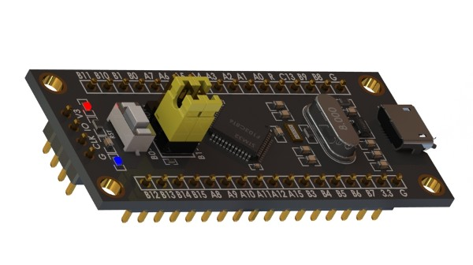
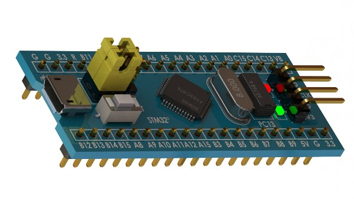

All images below are existing module photographs or KiCad library previews, not AI-generated images. Photos are illustrative module references; symbol/footprint previews are library assets rather than evidence of a manufactured board.

## Symbols

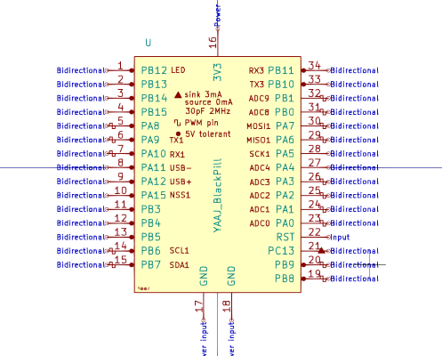
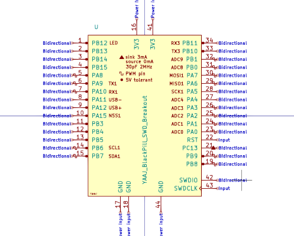
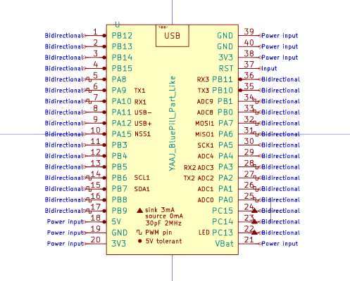
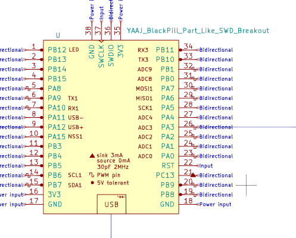
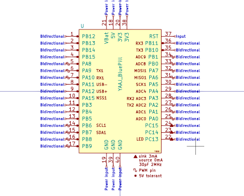
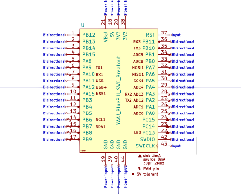

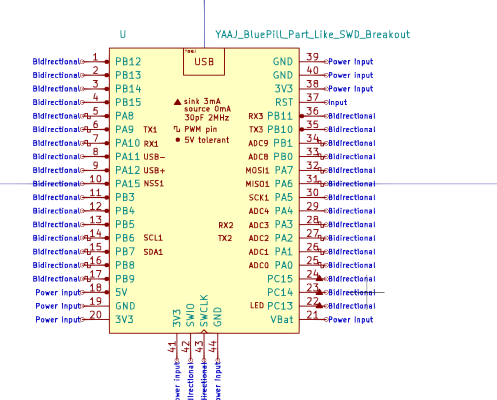

## Footprints

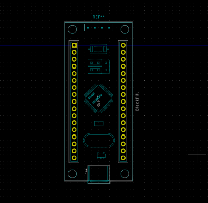
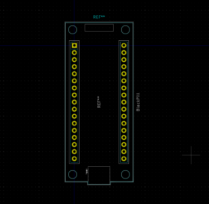
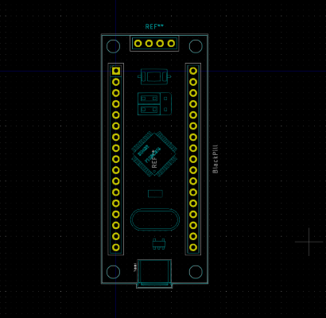
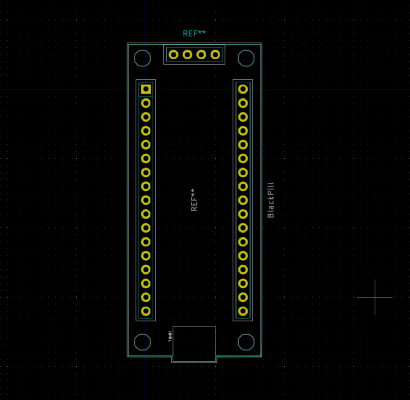

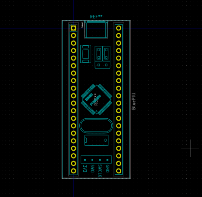
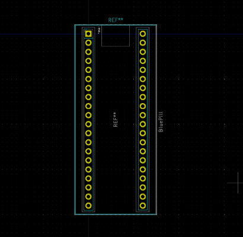
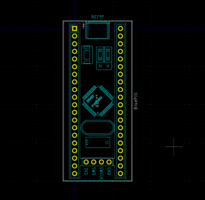
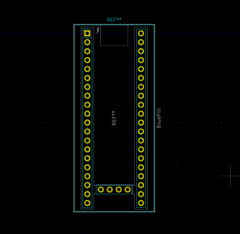

Naming for 3Dpackage files is probably not the best. English is not my first language...

**YAAJ_Module_STM32_BlackPill_No_Headers_cp** :

bare module, no headers

**YAAJ_Module_STM32_BlackPill_PinHeaders_B_SWD_Header_cp** :

pin headers, SWD header broken out on bottom

**YAAJ_Module_STM32_BlackPill_PinHeaders_H_SWD_Header_cp** :

pin headers, SWD port on top with horizontal pin header

**YAAJ_Module_STM32_BlackPill_PinHeaders_No_SWD_Header_cp** :

pin headers, no SWD port

**YAAJ_Module_STM32_BlackPill_PinHeaders_V_SWD_Header_cp** :

pin headers, SWD port on top with vertical pin header

**YAAJ_Module_STM32_BlackPill_PinSockets_B_SWD_Header_cp** :

pin headers on pin sockets, SWD header broken out on bottom

**YAAJ_Module_STM32_BlackPill_PinSockets_H_SWD_Header_cp** :

pin headers on pin sockets, SWD port on top with horizontal pin header

**YAAJ_Module_STM32_BlackPill_PinSockets_No_SWD_Header_cp** :

pin headers on pin sockets, no SWD port

**YAAJ_Module_STM32_BlackPill_PinSockets_V_SWD_Header_cp** :

pin headers on pin sockets, SWD port on top with vertical pin header

**YAAJ_Module_STM32_BluePill_No_Headers_cp** :

bare module, no headers

**YAAJ_Module_STM32_BluePill_PinHeaders_B_SWD_Header_cp** :

pin headers, SWD header broken out on bottom

**YAAJ_Module_STM32_BluePill_PinHeaders_H_SWD_Header_cp** :

pin headers, SWD port on top with horizontal pin header

**YAAJ_Module_STM32_BluePill_PinHeaders_No_SWD_Header_cp** :

pin headers, no SWD port

**YAAJ_Module_STM32_BluePill_PinHeaders_V_SWD_Header_cp** :

pin headers, SWD port on top with vertical pin header

**YAAJ_Module_STM32_BluePill_PinSockets_B_SWD_Header_cp** :

pin headers on pin sockets, SWD header broken out on bottom

**YAAJ_Module_STM32_BluePill_PinSockets_H_SWD_Header_cp** :

pin headers on pin sockets, SWD port on top with horizontal pin header

**YAAJ_Module_STM32_BluePill_PinSockets_No_SWD_Header_cp** :

pin headers on pin sockets, no SWD port

**YAAJ_Module_STM32_BluePill_PinSockets_V_SWD_Header_cp** :

pin headers on pin sockets, SWD port on top with vertical pin header
