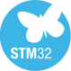
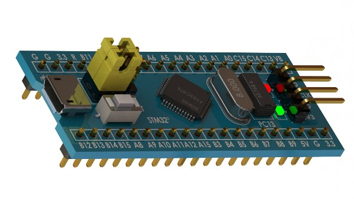

<table align="center">
  <tr>
    <td align="center" valign="middle" width="33%">
      
    </td>
    <td align="center" valign="middle" width="33%">
      
    </td>
    <td align="center" valign="middle" width="33%">
      
    </td>
  </tr>
</table>

STM32 Blue Pill / Black Pill reference · Arm Cortex core depends on the exact MCU variant

# Custom MCU Footprints

Folder MCU_Custom.pretty adalah library footprint KiCad dengan footprint Blue Pill dan silkscreen custom.

Tambahkan melalui Preferences → Manage Footprint Libraries. Periksa nickname/path, jumlah serta nomor pad, pitch, outline board, posisi USB/header, dan kecocokan dengan simbol. Setelah perubahan, update PCB from schematic, jalankan DRC, dan tinjau 3D view bila model tersedia.

---

[README utama repositori](../../../README.md)
