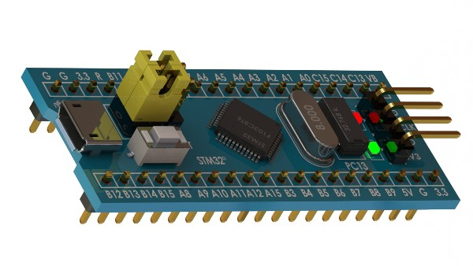
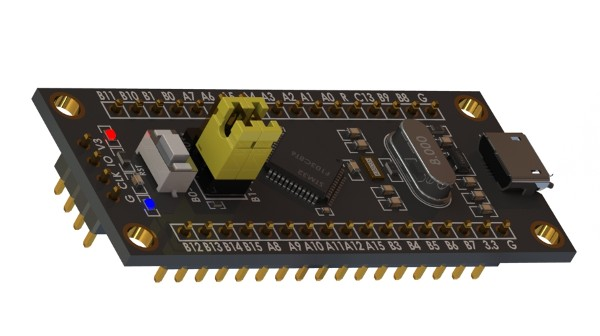

<table align="center">
  <tr>
    <td align="center" valign="middle" width="33%">
      
    </td>
    <td align="center" valign="middle" width="33%">
      
    </td>
    <td align="center" valign="middle" width="33%">
      
    </td>
  </tr>
</table>

STM32 Blue Pill / Black Pill reference · Arm Cortex core depends on the exact MCU variant

# KiCad Part Libraries

Folder ini mengelompokkan library komponen agar reusable antar-project.

  
  

Foto referensi nyata untuk modul yang direpresentasikan oleh library, bukan foto PCB buatan repository.

## Isi folder
- [Kicad-STM32](Kicad-STM32/README.md): simbol, footprint, dan model 3D untuk Blue Pill/Black Pill.
- [MCU_Custom.pretty](MCU_Custom.pretty/README.md): footprint MCU custom, termasuk outline/silkscreen Blue Pill.
- <code>MCU.kicad_sym</code>: symbol library kustom.
- <code>MCU.bak</code>: backup; periksa perbedaannya sebelum menjadikan sumber utama.

## Menggunakan
Tambahkan symbol lewat Preferences → Manage Symbol Libraries dan footprint lewat Preferences → Manage Footprint Libraries. Cocokkan nomor pin, pad, pitch, dan dimensi terhadap datasheet/modul fisik. Gunakan konfigurasi project-specific bila library hanya berlaku pada satu project.
